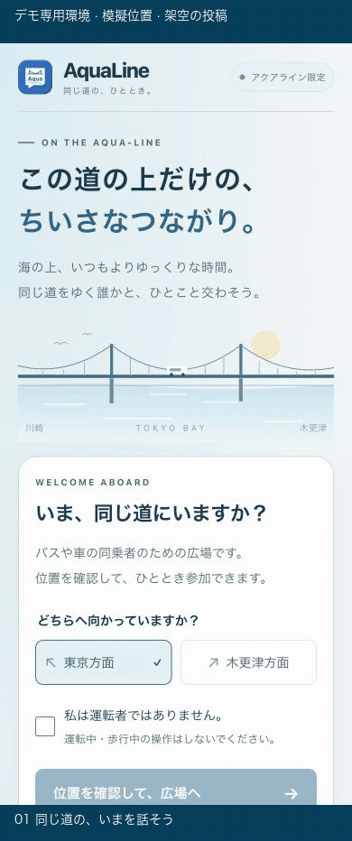

# AquaLine

**同じ道の、いまを話そう。**

アクアラインを通るバスや車の**乗客**のための、一時的な会話の広場。東京方面・木更津方面のタグを添えて、同じ道にいる人と短い言葉を交わすWebアプリです。海の青・波の白・橋のグレーを軸に、スマートフォンで読みやすく操作しやすいUIを目指しています。

> **乗客向けの非公式サービスです。** 運転者は渋滞中・停車中も利用対象外です。現地の位置判定や実スマートフォンでの動作は未検証です。

**公開URL：[AquaLine を開く](https://aqualine.mitubaex.com)**

旧URL `https://aqualine-mvp.mituba.workers.dev` も引き続き利用できます。両URLは同じWorker・Durable Objectの保存先を使用します。参加状態はブラウザのオリジンごとに保持するため、新URLでは位置情報の許可・参加確認が改めて必要です。

Cloudflare Workers と SQLite-backed Durable Objects を使用し、2026-10-29に Workers Free プランで公開しました。公開版の参加には範囲内の位置確認が必要で、模擬位置ボタンはありません。[保存先・費用・運用手順](docs/technical-notes.md)も確認してください。

公開環境でも、専用の合成測位データによるテストで投稿・別接続からの取得・切断後の再取得と削除を確認済みです。Cloudflare公式APIで保存データの存在も確認しました。これは現地GPSやサーバー再起動後の復元を検証したものではありません。

## 21秒で見る AquaLine



[高画質MP4を見る・ダウンロードする](docs/demo/aqualine-mobile.mp4) · [デモの条件と内容](docs/demo/README.md)

現在のUIを390px幅のローカルブラウザで操作し、7場面に編集したデモです。**専用テスト環境・模擬位置・架空のサンプル文**を使用しています。実GPS・実ユーザーの投稿・現地での動作確認を示すものではありません。

## できること

- 乗客確認と進行方向の選択、位置確認による参加。開発時は模擬位置でも入場できます。
- 乗車ごとの匿名表示名、140文字までの投稿と返信、3種類のリアクション。
- 通報は本人向けに即時非表示。異なる接続元3つで全体隔離し、内容を別枠で30日保持します。共有回線の票の重複や不当通報には限界があります。
- WebSocketでの更新、自分の投稿削除、ミュートと通報。
- 参加期限の表示と再確認。位置が不明な場合の猶予、エリア外での退出。
- スマホでの大きな操作ボタン、下端に追従する投稿欄、下書きを保つ返信取消。

写真・DM・フォロー・ランキングはありません。名前やメールアドレスの登録も不要です。

## 手元で試す

Node.js 24系とnpmを推奨します。

```bash
git clone https://github.com/mitubaEX/aqualine.git
cd aqualine
npm ci
npm run build
npm run dev
```

**http://127.0.0.1:5173** を開き、乗客確認にチェック → **「開発・動作確認用」→「テスト位置で入る（開発専用）」** を選んでください。実際の現在地は取得しません。通常の「位置を確認して、広場へ」とは別の操作です。

Viteが画面、ローカルWranglerがAPI・Durable Objectsを提供します。Cloudflareへのログインやデプロイは不要です。終了はターミナルで `Ctrl+C`。別ブラウザやシークレットウィンドウから参加すると、二者間の会話を試せます。テスト投稿もローカルの `.wrangler/` に保存されます。

## 検証と現在の限界

2026-11-04にMacで型検査・ビルド・61件のサーバーテスト・HTTP/WebSocket結合テスト・15件のブラウザE2Eが成功しました。過去のUI検証では375px・390pxのスマホ幅、横向き相当、デスクトップも確認しています。

```bash
npm run typecheck
npm test
npm run build
# npm run dev を別ターミナルで起動してから
npm run test:integration
CHROMIUM_PATH="/path/to/chromium" npm run test:e2e
```

ブラウザ試験は複数の新規参加を使います。接続元の参加上限と競合する場合は、独立したローカル状態のWranglerと、それに接続する開発Viteを使ってください（手順は技術メモ）。上限回避のために本番設定を緩めないでください。

MacのGoogle Chromeを使う場合、`CHROMIUM_PATH` は `/Applications/Google Chrome.app/Contents/MacOS/Google Chrome` です。

**実スマートフォン、実ソフトキーボード、iOS Safari、ノッチのsafe area、現地GPS・トンネル内の挙動は未検証です。** 道路境界は近似値で、クライアント座標の偽装は防げません。参加券は最後のエリア内確認から最大60分、通常の投稿は1日（24時間）で表示を終了し、保存データも削除対象になります。定期清掃の遅れや基盤のバックアップは別扱いです。通報内容は従来どおり30日保持します。

地理境界の実地検証、濫用対策、通報の人手運用などには未整備の項目があります。**正式版の名称は、現地での動作や常時監視・継続的な運営体制を保証するものではありません。** 詳しくは [SECURITY.md](SECURITY.md)、[実装・データ保持の詳細](docs/technical-notes.md)、[検証履歴](docs/validation-history.md) を参照してください。

橋上で範囲外になる不具合の補正根拠と検証点は [橋区間の位置判定](docs/geofence-source.md) を参照してください。国土地理院ベクトルタイル提供実験の道路データを加工して作成しています。現地GPSの成功確認ではありません。

トンネル・渋滞時は、入場済みなら最後のエリア内確認から最大60分参加できます。同じタブの再読み込みでは保存した参加券をサーバー確認して復元します。位置不明や再接続では延長せず、通信圏外での送信はできません。

参加範囲には、川崎側の高速道路3方向と木更津側連絡道の約3km、および接続ランプを含みます。一般道全域は対象ではありません。[形状・検証点・限界](docs/approach-corridors.md)を参照してください。中心線100m以内・精度80m以下は維持し、並行道路の一部が入る可能性はあります。退出は参加中のヘッダー右上、リアクションは狭幅でも説明と件数を併記します。


## ご意見・不具合

画面下部の「ご意見・不具合を送る」からGoogleフォームを新しいタブで開けます。参加や位置確認は不要です。回答は広場に公開せず、Googleフォームで運営が管理します。個人情報や緊急連絡は入力しないでください。[フィードバックの管理方法](docs/feedback.md)を参照してください。

### 混雑状況の固定共有と公開集計

広場では「激混み / 混み / 動いてる / 空いてる」の4段階を任意で投稿に付けられます。本文なしの状況共有も可能です。投稿には従来どおり、同乗者確認・エリア判定による有効な参加券が必要で、同じ投稿頻度制限が適用されます。方向と投稿時刻はサーバーが決定します。

`GET /api/congestion` だけは参加券・位置情報なしで読める公開集計です。直近15分の有効な投稿から、方向ごとに各参加券の最新回答1件を数え、3件以上で4段階の内訳と最多回答を表示します。同数最多は回答の分散として示し、0〜2件では判定しません。投稿本文・名前・ID・座標は返しません。画面は原則60秒ごとに更新し、日本時間の集計時刻と回答件数を表示します。更新失敗時は過去の集計を非表示にします。

任意の体感報告であり、公式情報や道路全体の測定値ではありません。人数ではなく参加券単位の回答数です。再参加による重複は除けず、位置確認後の60分猶予中の報告も含みます。削除・隔離済み投稿は集計対象外。集計用の追加個人データは保存しません。3件の表示基準は少数の直接公開を抑えるためで、繰り返し観測に対する数学的な匿名性の保証ではありません。
