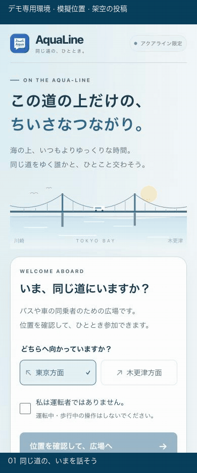

# AquaLine

**同じ道の、いまを話そう。**

アクアラインを通るバスや車の**乗客**のための、一時的な会話の広場。東京方面・木更津方面のタグを添えて、同じ道にいる人と短い言葉を交わすローカルMVPです。海の青・波の白・橋のグレーを軸に、スマートフォンで読みやすく操作しやすいUIを目指しています。

> **小規模な試験公開中のプロトタイプです。** 運転者は渋滞中・停車中も利用対象外です。現地の位置判定や実スマートフォンでの動作は未検証です。

**公開URL：[AquaLine を開く](https://aqualine-mvp.mituba.workers.dev)**

Cloudflare Workers と SQLite-backed Durable Objects を使用し、2026-10-29に Workers Free プランで公開しました。公開版の参加には範囲内の位置確認が必要で、模擬位置ボタンはありません。[保存先・費用・運用手順](docs/technical-notes.md)も確認してください。

公開環境でも、専用の合成測位データによるテストで投稿・別接続からの取得・切断後の再取得と削除を確認済みです。Cloudflare公式APIで保存データの存在も確認しました。これは現地GPSやサーバー再起動後の復元を検証したものではありません。

## 21秒で見る AquaLine



[高画質MP4を見る・ダウンロードする](docs/demo/aqualine-mobile.mp4) · [デモの条件と内容](docs/demo/README.md)

現在のUIを390px幅のローカルブラウザで操作し、7場面に編集したデモです。**専用テスト環境・模擬位置・架空のサンプル文**を使用しています。実GPS・実ユーザーの投稿・現地での動作確認を示すものではありません。

## できること

- 乗客確認と進行方向の選択、位置確認による参加。開発時は模擬位置でも入場できます。
- 乗車ごとの匿名表示名、140文字までの投稿と返信、3種類のリアクション。
- 通報は本人向けに即時非表示。異なる接続元3つで全体隔離し、内容を別枠で30日保持します。共有回線の票の重複や不当通報には限界があります。
- WebSocketでの更新、自分の投稿削除、ミュートと通報。
- 参加期限の表示と再確認。位置が不明な場合の猶予、エリア外での退出。
- スマホでの大きな操作ボタン、下端に追従する投稿欄、下書きを保つ返信取消。

写真・DM・フォロー・ランキングはありません。名前やメールアドレスの登録も不要です。

## 手元で試す

Node.js 24系とnpmを推奨します。

```bash
git clone https://github.com/mitubaEX/aqualine.git
cd aqualine
npm ci
npm run build
npm run dev
```

**http://127.0.0.1:5173** を開き、乗客確認にチェック → **「開発・動作確認用」→「テスト位置で入る（開発専用）」** を選んでください。実際の現在地は取得しません。通常の「位置を確認して、広場へ」とは別の操作です。

Viteが画面、ローカルWranglerがAPI・Durable Objectsを提供します。Cloudflareへのログインやデプロイは不要です。終了はターミナルで `Ctrl+C`。別ブラウザやシークレットウィンドウから参加すると、二者間の会話を試せます。テスト投稿もローカルの `.wrangler/` に保存されます。

## 検証と現在の限界

2026-10-29にMacで型検査・ビルド・35件のサーバーテスト・HTTP/WebSocket結合テスト・5件のブラウザE2Eが成功しました。375px・390pxのスマホ幅、横向き相当、デスクトップで確認しています。

```bash
npm run typecheck
npm test
npm run build
# npm run dev を別ターミナルで起動してから
npm run test:integration
CHROMIUM_PATH="/path/to/chromium" npm run test:e2e
```

ブラウザ試験は新規参加を5回使います。接続元の参加上限と競合する場合は、独立したローカル状態のWranglerと、それに接続する開発Viteを使ってください（手順は技術メモ）。上限回避のために本番設定を緩めないでください。

MacのGoogle Chromeを使う場合、`CHROMIUM_PATH` は `/Applications/Google Chrome.app/Contents/MacOS/Google Chrome` です。

**実スマートフォン、実ソフトキーボード、iOS Safari、ノッチのsafe area、現地GPS・トンネル内の挙動は未検証です。** 道路境界は近似値で、クライアント座標の偽装は防げません。参加券は20分、投稿は60分で通常表示から外れます。これは直ちに保存データを削除する意味ではありません。

広く利用を案内する前に、地理境界・濫用対策・通報運用・プライバシー方針などの整備が必要です。**試験公開は、現地での動作や継続的な運営体制を保証するものではありません。** 詳しくは [SECURITY.md](SECURITY.md)、[実装・データ保持の詳細](docs/technical-notes.md)、[検証履歴](docs/validation-history.md) を参照してください。
